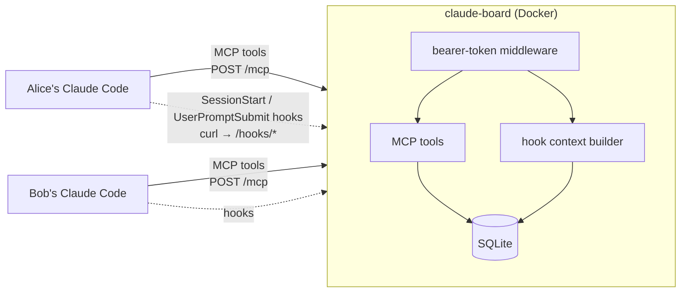

# Claude Board

[](https://github.com/stewartspicer/claude-board/actions/workflows/ci.yml)

**A shared task board for collaborators' Claude Code sessions.** When two people work on the same project, each with their own Claude, the first sign that a task is already underway is often the pull request. Claude Board gives every Claude one place to claim work, post progress and leave notes for each other, so duplicated work gets caught before it starts.

```
You:    Start on item 3 of the onboarding spec.
Claude: Task #1 "Write the onboarding guide" (ref: Spec Onboarding item 3) was claimed
        by alice a minute ago. Want me to message her, or pick up something else?
```

It's a self-hosted [MCP](https://modelcontextprotocol.io) server plus two Claude Code hooks: one small Python service and one SQLite file.

## Features

- **Claims.** `create_task` claims by default. A second Claude that tries to claim the same task is told who has it and since when. Claims idle for 7 days go *stale* and can be taken over.
- **Duplicate detection.** Tasks can reference a document section (`ref: "docs/specs/xyz.md item 8"`). A new task with the same ref, or a near-identical title, is refused, and the existing task is shown instead. "Item 8" and "item 9", or "bug #12" and "bug #13", count as different tasks.
- **Plans for working through a PRD together.** Load a PRD's items as unclaimed tasks under a plan, optionally tied to a shared branch. Each Claude claims the next item it picks up. Everyone sees `prd-checkout (branch feature/checkout): 5/12 done · claimed: alice #4 #7; bob #9 · 4 open` at session start. When an item is finished with its commit, the other Claude's next prompt says it *landed on feature/checkout in abc1234*, so it knows to pull.
- **Progress updates.** Claudes post their own updates ("PR #12 opened", "merged", "abandoned"), since they already use `gh`. The board never talks to GitHub.
- **Directed notes.** "Bob: install the code-search MCP, steps below." The recipient's Claude shows the note to its human, acts only with their OK, and acknowledges it. The acknowledgement is delivered back to the sender.
- **Automatic updates.** Claude Code hooks inject board activity into context: a summary at session start, then only what changed with each prompt. When nothing happened, the hooks add nothing, so the per-prompt cost is zero.
- **Per-person tokens.** Every post is attributed by the server ("from alice"), never by the client. Only token hashes are stored.

## How it works



- **MCP tools** (streamable HTTP at `/mcp`):
  - checking: `board_status`, `find_tasks`
  - task work: `create_task`, `claim_task`, `update_task`
  - plans: `define_plan`, `plan_status`
  - messages: `post_message`, `ack_note`
  - housekeeping: `list_projects`, `add_project_alias`
  The server's MCP instructions tell Claude to check before starting work, claim it, and post when PRs open or merge.
- **Hooks** forward Claude Code's hook input (session id, working directory) to `/hooks/session-start` and `/hooks/prompt`. The board works out the project from the folder name and answers with `additionalContext`.
- **Read positions** are tracked per (person, project) and per session. Bursts are paged 10 events at a time, so switching projects or a busy afternoon never skips anything.
- **Bulk imports collapse.** Loading a PRD shows up as one line ("alice added 12 tasks to plan prd-checkout (#1–#12)"), not twelve.
- **Every change is an event.** Task state changes, messages, notes and acks all land in one events table, which is what the hooks read from.

The design doc is in [docs/specs/2026-10-10-claude-board-design.md](docs/specs/2026-10-10-claude-board-design.md).

## Quick start

### 1. Run the server

```bash
cp .env.example .env              # set BOARD_PUBLIC_URL to the address collaborators will use
docker compose up -d --build
docker compose exec board python -m board.admin add-user alice    # prints alice's token once
docker compose exec board python -m board.admin add-user bob
```

Unraid users can use [deploy/unraid/](deploy/unraid/): `deploy.sh` builds on the server over SSH and installs the Docker template.

### 2. Connect each person's Claude Code

The board serves its own client setup guide at `http://<your-board>/setup` (source: [board/setup.md](board/setup.md)). The easiest route is to give each person their token and have them tell their Claude:

> Set up Claude Board for me by following http://myserver:8792/setup. My token is cb_…

That runs one `claude mcp add --scope user …` and merges an `env` block and two hooks into `~/.claude/settings.json`. It works on Windows, macOS and Linux and needs only `curl`. Restart Claude Code afterwards.

### Working through a PRD together

Tell one Claude:

> Put docs/prd-checkout.md on the board as plan `prd-checkout` on branch `feature/checkout`, one unclaimed task per item.

It calls `define_plan`, then `create_task(..., plan="prd-checkout", ref="PRD Checkout item N", claim=false)` for each item in order. After that, either person can say "pick up the next item from the checkout PRD". Their Claude checks `plan_status`, claims an open item, implements it, and marks it done with its commit. Each Claude sees the other's claims and finished items as they happen.

### Configuration

| Variable | Default | Purpose |
|---|---|---|
| `BOARD_PUBLIC_URL` | `http://localhost:8792` | Address clients use. Written into `/setup`, and its host is accepted automatically. |
| `BOARD_ALLOWED_HOSTS` | *(empty)* | Extra `Host` headers for `/mcp`'s DNS-rebinding protection, as comma-separated `host:port` patterns (`host:*` = any port) |
| `DATA_DIR` | `/data` in the container | SQLite location |

Admin CLI: `python -m board.admin add-user | rotate-token | deactivate | list-users`.

## Security model

- It's built for a **private network** (LAN or Tailscale). Tokens are bearer credentials over plain HTTP there, so put the board behind HTTPS before exposing it more widely.
- **Notes are relayed, never executed.** Board content is data to the reading Claude. The MCP instructions and hook text describe notes as teammate requests, and anything that changes the reader's machine requires their human's approval. In end-to-end tests with real Claude Code sessions, the recipient surfaced the note, asked, and only then acted and acknowledged.
- `/mcp` rejects unexpected `Host` headers (DNS-rebinding protection), and every route except `/healthz` and `/setup` requires a token.

## Notes from building it

- **Claude Code HTTP hooks didn't fit.** They aren't allowed on `SessionStart`, and they refuse private and tailnet addresses (`HTTP hook blocked: … resolves to 100.x (private/link-local address)`). The hooks are therefore `curl` command hooks, and the server side didn't change.
- **The token lives in `settings.json`'s `env` block.** That one setting reaches both the hook commands and the `${CLAUDE_BOARD_TOKEN}` expansion in the MCP server's header, so nobody edits shell profiles. That matters on macOS, where GUI-launched apps don't read `~/.zshrc`.
- **MCP Python SDK v2** (`MCPServer`) is mounted inside FastAPI at `/` with `streamable_http_path="/mcp"`, in stateless JSON mode. Mounting it at `/mcp` triggers a trailing-slash redirect that breaks POST.

## Development

```bash
uv sync
uv run pytest                                  # unit, HTTP and MCP round-trip tests
uv run ruff format . && uv run ruff check .
DATA_DIR=./data uv run uvicorn board.app:create_app --factory --port 8792
```

| Module | Role |
|---|---|
| `board/board.py` | Domain logic: claims, duplicates, notes, cursors. Pure functions over SQLite. |
| `board/mcp_tools.py` | Thin MCP wrappers around the domain logic |
| `board/hooks.py` | Hook context and read cursors |
| `board/app.py` | FastAPI app, MCP mount, auth, config |
| `board/admin.py` | User management CLI |

## Possible next steps

- **GitHub poller:** turn merges done in the web UI into board events, for when nobody's Claude posted them.
- **A read-only web page** for humans.
- **Mid-turn push** with Claude Code channels, once they leave research preview (they currently need a local stdio server).

## License

[MIT](LICENSE)
